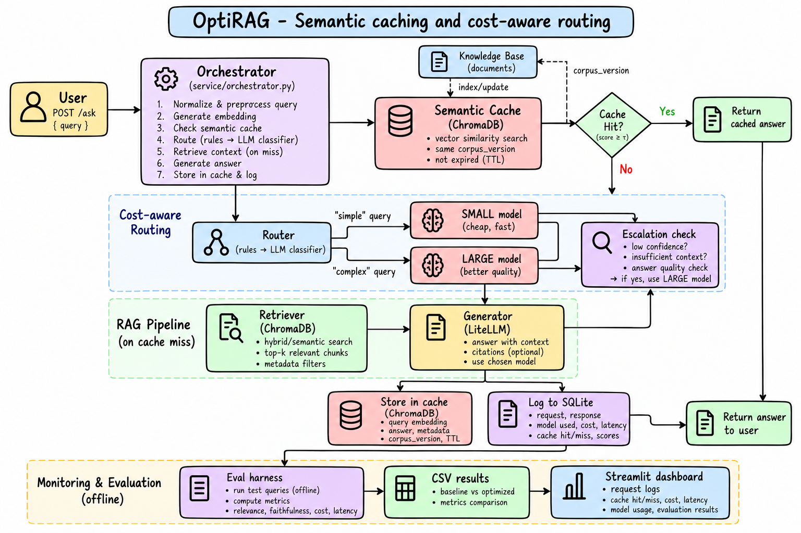

# OptiRAG

A RAG service that answers questions over your documents while cutting LLM cost and latency, using **semantic caching**, **cost-aware model routing** and **escalation to a larger model** when the small one isn't good enough.

<!-- TODO: add the system architecture diagram here, e.g. docs/architecture.png -->


## How it works

1. **Cache check**: the question is normalized and embedded. If a similar question was answered before (cosine similarity ≥ threshold), the stored answer and sources are returned with no LLM call.
2. **Retrieve**: on a miss, the top-k chunks are fetched from the vector store.
3. **Route**: a rule-based router (or an optional LLM classifier) sends simple questions to the small model and complex ones to the large model.
4. **Escalate**: if the small model's answer has low retrieval scores, says "no answer", or has no citation, it is regenerated on the large model.
5. **Cache and log**: good answers are cached; every request is logged to SQLite (tokens, cost, latency, route).

**Cache invalidation:** entries are tagged with a `corpus_version` (a hash of the documents and chunking/embedding settings) and a TTL. When the corpus changes, old entries are dropped. Entries are also separated per tenant, and empty or "no answer" replies are never cached.

## Stack

Python 3.12 · FastAPI · ChromaDB · sentence-transformers (`BAAI/bge-small-en-v1.5`) · LiteLLM (Groq `gpt-oss-20b` / `gpt-oss-120b`) · SQLite · Streamlit · pytest · uv

## Project layout

```
src/optirag/   config, ingest, retriever, rag, cache, router, pipeline, request_log, api
eval/          judge, run_eval, tune_threshold, eval_router, benchmark
dashboard/     Streamlit monitoring app
data/corpus/   your documents (PDF, TXT, MD)
data/eval/     eval questions, cache pairs, router labels
tests/         unit tests
```

## Setup

```bash
git clone https://github.com/Mudassir-A/optirag.git
cd optirag
cp .env.example .env        # add your GROQ_API_KEY
make sync                   # install dependencies
# put your documents in data/corpus/
make ingest                 # build the vector index
```

## Usage

```bash
make api      # FastAPI at http://localhost:8000/docs
make dash     # Streamlit dashboard
make test     # unit tests
```

Example request:

```bash
curl -X POST http://localhost:8000/ask \
  -H "Content-Type: application/json" \
  -d '{"question": "What was the S&P 500 return in 2024?"}'
```

| Endpoint | Purpose |
|---|---|
| `POST /ask` | Optimized pipeline (cache, routing, escalation) |
| `POST /ask/baseline` | Baseline: always the large model, no cache |
| `POST /ingest` | Re-ingest the corpus and refresh the cache version |

## Evaluation

```bash
make eval     # run the eval set on baseline and optimized, judge answer quality
make tune     # sweep cache similarity thresholds on paraphrase / near-miss pairs
make router   # measure router accuracy on labeled queries
make bench    # baseline vs optimized on repeat traffic, writes results/
```

Reported metrics: retrieval hit rate, answer quality (LLM judge), cost per request, cache hit rate, escalation rate, and p50 / p95 latency.

### Results

> Fill this table from your own `make bench` run (`results/benchmark.json`). Don't report numbers you haven't measured.

| Metric | Baseline | OptiRAG | Change |
|---|---|---|---|
| Cost per request (USD) | | | |
| p50 latency (ms) | | | |
| p95 latency (ms) | | | |
| Cache hit rate | n/a | | |
| Answer quality | | | |
| Retrieval hit rate | | | |

Eval set size: _N_ questions. Corpus: _N_ documents. Model prices are list prices set in `src/optirag/config.py`.

## Configuration

All settings are environment variables (see `.env.example`): models, chunk size, `OPTIRAG_RETRIEVAL_K`, `OPTIRAG_CACHE_THRESHOLD`, `OPTIRAG_CACHE_TTL_HOURS`, `OPTIRAG_ROUTER_MODE` (`rules` or `llm`), `OPTIRAG_ROUTER_THRESHOLD`, `OPTIRAG_ESCALATE_BELOW`. API keys live in `.env`, which is git-ignored.

## License

MIT